  

  &nbsp;
  

## Education

- **University of Wisconsin–Madison** — B.S. Computer Science (2021–2024)

## Certifications

- **CCNA — Cisco Certified Network Associate** · Nov 2026 · [Verify on Credly](https://www.credly.com/badges/f7b83dc8-997e-4b81-b3c5-839c0342e858/public_url)
